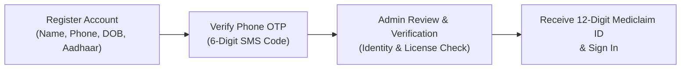
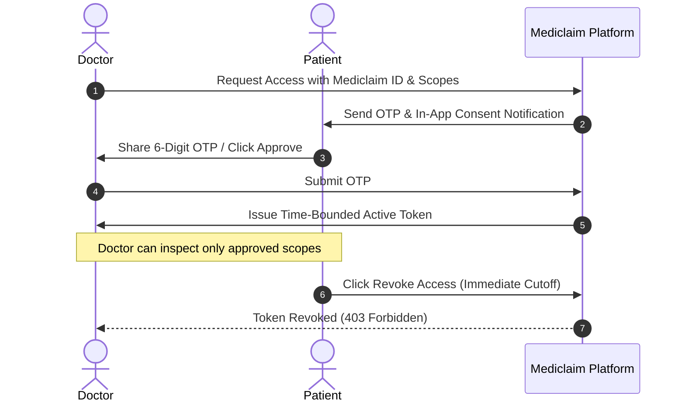

# Mediclaim User Guide

> **Your Complete Guide to Navigating the Mediclaim Digital Health Platform**  
> *For Patients, Healthcare Practitioners, Hospital Administrators, and Platform Staff.*

---

## Table of Contents

1. [Introduction to Mediclaim](#1-introduction-to-mediclaim)
   - [What is Mediclaim?](#what-is-mediclaim)
   - [The 12-Digit Mediclaim ID](#the-12-digit-mediclaim-id)
   - [Privacy, Security & Patient Sovereignty](#privacy-security--patient-sovereignty)
2. [Getting Started: Registration & Account Activation](#2-getting-started-registration--account-activation)
   - [Step 1: Patient Registration](#step-1-patient-registration)
   - [Step 2: Phone OTP Verification](#step-2-phone-otp-verification)
   - [Step 3: Administrator Verification & ID Activation](#step-3-administrator-verification--id-activation)
   - [Step 4: Signing In with Your Mediclaim ID](#step-4-signing-in-with-your-mediclaim-id)
3. [Patient Portal (`/app`)](#3-patient-portal-app)
   - [Profile Completion & Emergency Contacts](#profile-completion--emergency-contacts)
   - [The Lifelong Timeline & Birth Milestone](#the-lifelong-timeline--birth-milestone)
     - [Birth Date as Foundational Origin](#birth-date-as-foundational-origin)
     - [Missing Certificate Indicators & Clinical Hints](#missing-certificate-indicators--clinical-hints)
     - [Uploading & Merging Your Birth Record](#uploading--merging-your-birth-record)
   - [AI Medical Document Ingestion (Gemini Multimodal OCR)](#ai-medical-document-ingestion-gemini-multimodal-ocr)
     - [Uploading Prescriptions and Scans](#uploading-prescriptions-and-scans)
     - [Live Document Preview & Structured Verification](#live-document-preview--structured-verification)
     - [Manual "Upload Anyway" Fallback](#manual-upload-anyway-fallback)
   - [Interactive Health Graph](#interactive-health-graph)
   - [All Records Directory & Search (`/app/records`)](#all-records-directory--search-apprecords)
   - [Requesting Medical Record Corrections](#requesting-medical-record-corrections)
   - [Access Control & Doctor Consent Governance (`/app/access`)](#access-control--doctor-consent-governance-appaccess)
     - [Reviewing & Approving Doctor Access Requests](#reviewing--approving-doctor-access-requests)
     - [Granular Scope Permissions & Time-Bounded Grants](#granular-scope-permissions--time-bounded-grants)
     - [Instant Access Revocation](#instant-access-revocation)
     - [Family Caregiver Delegation](#family-caregiver-delegation)
     - [Emergency Break-Glass Audit Trail](#emergency-break-glass-audit-trail)
4. [Doctor & Practitioner Portal (`/app/doctor`)](#4-doctor--practitioner-portal-appdoctor)
   - [Practitioner Sign-In & Dashboard](#practitioner-sign-in--dashboard)
   - [Requesting Patient Access by Mediclaim ID](#requesting-patient-access-by-mediclaim-id)
   - [Patient OTP Authorization](#patient-otp-authorization)
   - [Consultation View & Longitudinal Record Inspection](#consultation-view--longitudinal-record-inspection)
   - [Recording Clinical Data (Diagnoses, Prescriptions, Lab Tests, Vaccines)](#recording-clinical-data)
   - [Emergency Break-Glass Override Protocol](#emergency-break-glass-override-protocol)
   - [Access Session History & Automatic Expiration](#access-session-history--automatic-expiration)
5. [Healthcare Organization Portal (`/app/hospital`)](#5-healthcare-organization-portal-apphospital)
   - [Hospital Dashboard Overview](#hospital-dashboard-overview)
   - [Practitioner Directory & License Verification](#practitioner-directory--license-verification)
   - [Active Patient Roster](#active-patient-roster)
6. [Administrator Portal (`/admin`)](#6-administrator-portal-admin)
   - [Executive Overview & Real-Time KPIs](#executive-overview--real-time-kpis)
   - [User Verification Lifecycle (`/admin/verifications`)](#user-verification-lifecycle-adminverifications)
     - [Pending, Verified, and All Tabs](#pending-verified-and-all-tabs)
     - [Search & Filter Criteria](#search--filter-criteria)
     - [User Demographics & Identity Inspection Modal](#user-demographics--identity-inspection-modal)
     - [Issuing & Activating Mediclaim IDs](#issuing--activating-mediclaim-ids)
   - [Patient Directory (`/admin/patients`)](#patient-directory-adminpatients)
   - [Practitioner Directory (`/admin/practitioners`)](#practitioner-directory-adminpractitioners)
   - [Healthcare Organizations (`/admin/organizations`)](#healthcare-organizations-adminorganizations)
   - [Emergency Break-Glass Audit & Clinical Adjudication (`/admin/emergency`)](#emergency-break-glass-audit--clinical-adjudication-adminemergency)
7. [Frequently Asked Questions (FAQ)](#7-frequently-asked-questions-faq)

---

## 1. Introduction to Mediclaim

### What is Mediclaim?
Mediclaim is a sovereign, citizen-first digital health record platform designed to unite your entire medical history in one secure, accessible place. Instead of carrying paper folders, faded prescriptions, or fragmented diagnostic CDs from clinic to clinic, Mediclaim provides an HL7 FHIR-compliant longitudinal record that spans your life from birth to today.

### The 12-Digit Mediclaim ID
Every citizen is issued a standardized, unique **12-digit Mediclaim ID** (formatted as `XXXX XXXX XXXX`, e.g., `4821 9306 1175`). 
- **Privacy First**: Your Mediclaim ID is completely separate from your Aadhaar or national identity number.
- **Provider Recognition**: Any doctor, hospital, or diagnostic center across India can look up your records using this single identifier, provided you grant them consent.

### Privacy, Security & Patient Sovereignty
- **You Own Your Data**: Doctors and hospitals have zero default access to your files. They can only view records when you approve their request.
- **Granular Scopes**: You choose whether a doctor sees your allergies, medications, past conditions, or diagnostic scans.
- **Time Limits**: Access automatically expires after the agreed duration (e.g. 1 hour or 24 hours), or you can click "Revoke" at any time for immediate cutoff.

---

## 2. Getting Started: Registration & Account Activation

### Step 1: Patient Registration
1. Navigate to the Mediclaim homepage and click **Get Started** or visit `/register`.
2. Enter your:
   - **Full Legal Name**
   - **Date of Birth** (Crucial: this date anchors your lifelong health timeline)
   - **Phone Number**
   - **Aadhaar Number** (Used strictly for one-time deduplication; never stored in plaintext)
   - **Password** (Must be strong: minimum 8 characters, containing uppercase, lowercase, numbers, and symbols)
3. Click **Continue**.

### Step 2: Phone OTP Verification
1. You will be redirected to the `/verify-otp` screen.
2. Enter the 6-digit one-time password dispatched to your mobile number.
3. Once entered, your phone number is verified.

### Step 3: Administrator Verification & ID Activation
For medical-grade legal compliance and identity protection:
- Newly registered accounts enter `pending_admin_approval` status.
- A platform administrator reviews your application in the administrative portal to prevent duplicate identities.
- Once approved, your official **12-digit Mediclaim ID** is generated and activated. In development mode, the ID and OTP are printed directly in the server console logs.

### Step 4: Signing In with Your Mediclaim ID
1. Go to `/login`.
2. Enter your **12-digit Mediclaim ID** (spaces are optional) and your **Password**.
3. Click **Sign in** to access your dashboard.

---

## 3. Patient Portal (`/app`)

### Profile Completion & Emergency Contacts
Upon your first login, if your profile is incomplete, a modal will prompt you to provide:
- **Gender & Blood Group** (e.g., `O+`, `B+`, `AB-`)
- **Residential Address**
- **Emergency Contact**: Name, phone number, and relation (`Parent`, `Spouse`, `Sibling`, `Child`, `Guardian`). In critical situations, emergency personnel and hospital triage staff use these details immediately.

---

### The Lifelong Timeline & Birth Milestone

Your timeline maps every medical milestone in chronological order, with the oldest event anchored at your birth.

#### Birth Date as Foundational Origin
- Your birth date provided during registration automatically forms the **first milestone** on your timeline.
- Even if you haven't uploaded any medical documents yet, your timeline will never appear blank; it starts with your **Birth Record**.

#### Missing Certificate Indicators & Clinical Hints
- If you haven't yet uploaded an official birth certificate, maternity discharge card, or neonatal immunization slip, the timeline displays:
  - An amber **Missing certificate** badge.
  - Helpful clinical hints:  
    > 💡 *Upload your birth certificate, maternity card, or neonatal vaccinations like Hepatitis B (birth dose) and BCG.*
  - A direct **Upload birth certificate** button.

#### Uploading & Merging Your Birth Record
- When you click **Upload birth certificate** or add a manual birth report:
  - The system pre-fills your birth date.
  - When uploaded, the platform verifies that the record date matches your birth date.
  - Upon matching, it **merges seamlessly** with your existing birth milestone, updating its status to **Verified birth certificate**, attaching the file preview, and removing the missing certificate reminder.

---

### AI Medical Document Ingestion (Gemini Multimodal OCR)

Mediclaim incorporates Google DeepMind's Gemini multimodal AI to convert physical paper prescriptions and lab printouts into structured, searchable digital records.

#### Uploading Prescriptions and Scans
1. In your dashboard or timeline, click **Upload record** (or drag and drop a file).
2. Supported formats: **PDF, PNG, JPEG, WEBP** (up to 10 MB).
3. Gemini automatically reads the document:
   - Reads doctor handwriting, clinical notes, and clinic letterheads.
   - Identifies medications, dosages, routes, and refill instructions.
   - Extracts diagnoses, onset dates, and lab test values with reference ranges.

#### Live Document Preview & Structured Verification
- While parsing, an animated scanning indicator and document preview appear.
- Once extracted, the platform presents an editable verification form side-by-side with your document:
  - **Prescriptions**: Doctor name, clinic, medications, and dosage.
  - **Conditions**: Diagnosed illness and severity.
  - **Vaccines**: Vaccine brand, dose number, and administration date.
  - **Lab Results**: Test parameter, observed value, unit, and flag (`Normal`, `High`, `Low`).
- You can edit any field before clicking **Save to Timeline**.

#### Manual "Upload Anyway" Fallback
- If a document is torn, smudged, or unreadable by AI:
  - A notification appears: *"Failed to extract data, upload anyway"*.
  - You can enter the title, doctor, and date manually.
  - Your file is still securely stored and remains previewable on your timeline.

---

### Interactive Health Graph
Located under the **Graph** tab in `/app/timeline`:
- Powered by `@xyflow/react` and D3 hierarchical algorithms.
- Places you at the center node with your name and birth year.
- Radiates outward to five colored category nodes:
  - 🔴 **Allergies**
  - 🔵 **Conditions**
  - 🟣 **Medicines**
  - 🟢 **Vaccinations**
  - 🟡 **Reports & Lab Tests**
- Click on any category node to expand leaf records or zoom into specific clinical histories.

---

### All Records Directory & Search (`/app/records`)
A searchable, categorized table of everything in your medical file:
- Filter instantly by **Kind**: Allergies, Conditions, Medicines, Vaccinations, Reports.
- Real-time search: Type a drug name, doctor name, hospital, or test result to filter records immediately.
- Click any record to inspect the **Record Detail Dialog**, view full clinical notes, and preview attached files.

### Requesting Medical Record Corrections
If you spot an inaccuracy in a doctor-entered note or diagnosis:
1. Open the record detail dialog.
2. Click **Request a correction**.
3. Specify the discrepancy and provide proposed corrected text.
4. Your request is logged under `/app/records` and submitted to the authoring doctor/admin for formal review.

---

### Access Control & Doctor Consent Governance (`/app/access`)

You retain complete governance over who can inspect your medical history.

#### Reviewing & Approving Doctor Access Requests
- When a doctor needs to see your history, they initiate an access request.
- You receive an instant notification and an SMS OTP.
- You can either read the 6-digit OTP to your doctor or approve the request directly from your **Access Control** dashboard.

#### Granular Scope Permissions & Time-Bounded Grants
For every grant, you can toggle individual scopes on or off:
- `Allergies`
- `Conditions`
- `Medicines`
- `Vaccinations`
- `Reports & Lab Work`
- **Duration**: Choose from 1 hour, 2 hours, 8 hours, or 24 hours. Once the timer reaches zero, access expires automatically.

#### Instant Access Revocation
- Under **Active Grants**, you see a live countdown for every doctor who currently has access.
- Click **Revoke** at any time. The doctor's access token is invalidated immediately on the server.

#### Family Caregiver Delegation
- Add family members (e.g. elderly parents, spouses, or children) as authorized caregivers.
- Caregivers receive read-only permissions to specified scopes without needing full account credentials.

#### Emergency Break-Glass Audit Trail
- In acute life-threatening situations where a patient is unconscious, trauma doctors can initiate an **Emergency Break-Glass Override**.
- This bypasses consent but triggers an immutable audit log:
  - Your registered phone and emergency contacts receive an alert.
  - The doctor must document clinical justification (e.g., `TRAUMA_RESUSCITATION`, `ACUTE_CORONARY`).
  - The session appears permanently in your **Emergency Access History**.

---

## 4. Doctor & Practitioner Portal (`/app/doctor`)

### Practitioner Sign-In & Dashboard
- Doctors sign in using their registered credentials and medical license identifier.
- The dashboard displays active patient consultations, pending access requests, and quick links to recent patients.

### Requesting Patient Access by Mediclaim ID
1. Navigate to `/app/doctor/request-access`.
2. Enter the patient's **12-digit Mediclaim ID**.
3. Select the required clinical scopes and estimated consultation duration.
4. Click **Send Access Request**.

### Patient OTP Authorization
1. The patient receives an SMS verification code.
2. Enter the 6-digit OTP provided by the patient to activate the clinical session.

### Consultation View & Longitudinal Record Inspection
- Once approved, navigate to `/app/doctor/patients/:mediclaimId`.
- The practitioner can view:
  - Critical allergies & severity ratings highlighted at the top.
  - Active chronic conditions and maintenance medications.
  - Historical hospitalizations and diagnostic reports.
  - Verified birth records and vaccination records.
- Records outside the approved scope are automatically masked.

### Recording Clinical Data
During or after the consultation, the doctor can add entries that permanently attach to the patient's record:
- **Consultation Encounter**: Summary of clinical findings.
- **Diagnosis**: Add chronic or acute conditions with ICD-10 notes.
- **Digital Prescription**: Add medication names, dosages, frequencies, and duration.
- **Diagnostic Orders**: Order lab tests or radiology scans.
- **Vaccinations**: Log administered immunizations with batch numbers.

### Emergency Break-Glass Override Protocol
In severe emergencies (unconscious trauma patient, stroke, cardiac arrest):
1. Navigate to `/app/doctor/request-access`.
2. Toggle **Emergency Break-Glass Protocol**.
3. Enter the patient's Mediclaim ID, select the emergency type (`TRAUMA_RESUSCITATION`, `ACUTE_CORONARY`, `STROKE_THROMBOLYSIS`), and provide mandatory clinical justification notes.
4. Immediate read access to critical allergies, blood group, and conditions is granted.
5. The session is permanently flagged for hospital and administrative audit.

### Access Session History & Automatic Expiration
- Located at `/app/doctor/access-history`.
- Displays a chronological log of all past patient sessions, duration, scopes accessed, and reason for access.

---

## 5. Healthcare Organization Portal (`/app/hospital`)

Designed for hospital receptionists, department heads, and medical records administrators:

### Hospital Dashboard Overview
- Real-time census of patients currently admitted or consulting at the hospital.
- Departmental breakdowns (Emergency, Outpatient, Cardiology, Pediatrics).

### Practitioner Directory & License Verification
- Directory of all physicians, surgeons, and nurses affiliated with the hospital.
- Tracks medical license numbers, clinical specialties, and active hospital credentials.

### Active Patient Roster
- Comprehensive roster of all patients who have granted active consent to the hospital or its medical staff.
- Facilitates inter-departmental referrals and inpatient care continuity.

---

## 6. Administrator Portal (`/admin`)

The Administrative Portal manages platform-wide security, verification lifecycles, and institutional compliance.

### Executive Overview & Real-Time KPIs
- **Registered Patients**: Total registered citizens on the platform.
- **Pending Verifications**: Registrations awaiting identity verification.
- **Verified Practitioners**: Total licensed doctors onboarded.
- **Affiliated Hospitals**: Total certified healthcare facilities.
- **Emergency Overrides**: Total break-glass overrides executed in the last 30 days.

---

### User Verification Lifecycle (`/admin/verifications`)

#### Pending, Verified, and All Tabs
- **Pending**: New registrations awaiting identity approval and ID assignment.
- **Verified**: Active users with assigned, functioning Mediclaim IDs.
- **All**: Comprehensive directory of all registered accounts.

#### Search & Filter Criteria
- Search instantly by **Name**, **Phone number**, **Mediclaim ID**, or **Aadhaar reference**.
- Paginated table with real-time status indicators.

#### User Demographics & Identity Inspection Modal
- Clicking on any user opens the **User Detail Modal**:
  - Full legal name, date of birth, age, and blood group.
  - Residential address and phone number.
  - Emergency contact details.
  - Registration timestamp and verification status.

#### Issuing & Activating Mediclaim IDs
- Once identity documents are validated, clicking **Verify User** issues the citizen their official 12-digit Mediclaim ID, moves their status to active, and enables account login.

---

### Patient Directory (`/admin/patients`)
- Platform-wide master patient registry.
- Filter and search across all patients.
- Click any row to open the full demographic and profile inspection dialog.

### Practitioner Directory (`/admin/practitioners`)
- Medical staff registry.
- Filter by hospital affiliation or clinical specialization.
- Inspect doctor profiles, medical council registration numbers, and active hospital privileges.

### Healthcare Organizations (`/admin/organizations`)
- Manage hospitals, clinics, and diagnostic labs.
- Register new healthcare centers, update bed counts, and link medical staff.

### Emergency Break-Glass Audit & Clinical Adjudication (`/admin/emergency`)
- Real-time feed of every emergency override executed across the platform.
- Displays:
  - Doctor name and hospital.
  - Patient Mediclaim ID.
  - Emergency clinical justification.
  - Timestamp and IP address.
- Administrators can flag sessions for mandatory medical board review if justification is insufficient.

---

## 7. Frequently Asked Questions (FAQ)

#### Q: How do I find my 12-digit Mediclaim ID?
Your Mediclaim ID is displayed in the top navigation bar of your patient dashboard and under your profile summary card (e.g. `4821 9306 1175`). You can copy it with one click.

#### Q: Can a doctor access my records without my permission?
No. Except in audited, life-threatening emergency break-glass situations, no practitioner can access your data without your explicit OTP verification or in-app consent approval.

#### Q: Why is my birth date on the timeline before I upload anything?
Your birth date from registration anchors your lifelong health record. It ensures that whenever you upload pediatric records, childhood vaccinations (BCG, Polio), or your official birth certificate, they sit in their natural chronological place.

#### Q: What files can I upload to the AI parser?
Mediclaim supports PDF documents and image files (PNG, JPEG, WEBP) up to 10 MB. The AI works with both scanned printouts and photos taken with your smartphone.

#### Q: What if the AI misreads a drug name on my prescription?
Before any AI-parsed document is saved to your timeline, you are presented with an editable verification form alongside a live preview of your original file. You can correct or adjust any medication name, dosage, or date before saving.
